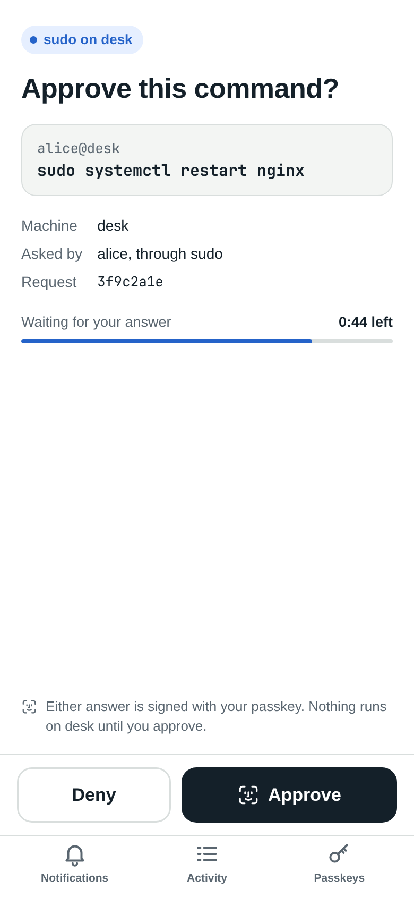
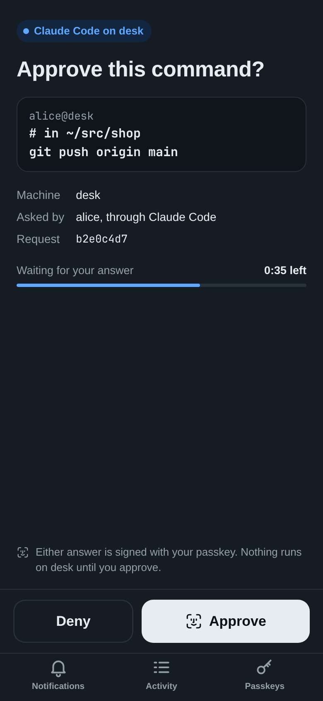
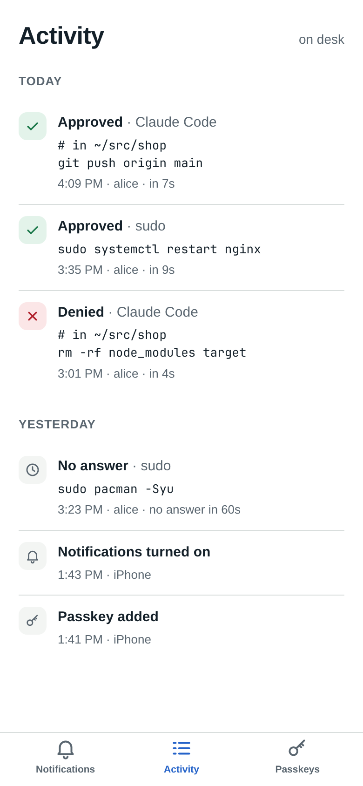

<p align="center"></p>

# Aye

Approve `sudo` (and Claude Code's permission prompts) from your phone, with a
passkey and Face ID, over your Tailscale network.

When something on the machine needs approval, `ayed` sends a Web Push
notification to the Aye web app on your phone's Home Screen. The
notification says only what kind of request it is. Tapping it opens a page
that shows the exact command, and Approve or Deny is signed with a passkey that
only works for this machine. No answer in 60 seconds counts as no answer: sudo
falls back to your password, and Claude Code shows its own prompt.

```
sudo / Claude Code ──► aye ──► ayed (/run/aye/ask.sock) ──► Web Push ──► phone
                                 ▲                                      │
                                 └────── signed answer (Face ID) ◄──────┘
                               pages on https://<machine>.<tailnet>.ts.net
```

<p align="center">
  
  
  
</p>
<p align="center"><sub>A sudo request, a Claude Code request (dark mode), and the Activity tab. Sample data.</sub></p>

Nothing to install on the phone: the app is the pages ayed serves, added
to the Home Screen. It has three tabs:

- **Notifications**: turn them on for this device, or send a test.
- **Activity**: requests waiting now, and a history of every approval,
  denial, timeout and cancellation (which passkey signed, how long it took),
  plus changes to passkeys, devices and registration. It shows commands, so it
  opens with Face ID and stays unlocked for 15 minutes.
- **Passkeys**: how many are registered, and adding one while registration
  is open.

## What's in here

| Path | What it is |
| --- | --- |
| `src/bin/ayed.rs` | The daemon: local API, Web Push, the pages, control socket, and the `ayed` CLI |
| `src/bin/*.html`, `sw.js` | The Home Screen app: notifications setup, approval and passkey pages, service worker |
| `src/bin/aye.rs` | The client: a PAM helper for sudo, a Claude Code hook, and the admin commands (it runs `ayed`) |
| `deploy/setup.sh` | Installs ayed and `tailscale serve` on this machine (Linux, systemd) |
| `deploy/pam.sh` | Adds phone approval to sudo (`test`, `install`, `remove`) |
| `deploy/claude-hook.sh` | Adds the Claude Code hook to `~/.claude/settings.json` (`install`, `remove`) |
| `deploy/macos/` | The same for a Mac: `setup.sh` (launchd), `pam.sh` (`sudo_local`) |
| `pam/pam_aye.c` | The PAM module that runs `aye` on macOS, which has no `pam_exec` |
| `assets/icon.svg` | The app icon; the PNGs in `assets/` and `src/bin/icon-*.png` are made from it |
| `docs/` | The screenshots in this README |

## Setup

Needs Tailscale with HTTPS enabled for the tailnet, `jq`, a Rust toolchain,
systemd, and an iPhone on iOS 16.4 or later (or any current browser). For a
Mac, see [On a Mac](#on-a-mac). Run
everything below from a normal terminal: `sudo` doesn't work inside the Claude
app's terminal.

1. Build:

   ```bash
   cargo build --release
   ```

2. Install ayed and the Tailscale HTTPS endpoint. The script finds this
   machine's Tailscale name by itself:

   ```bash
   deploy/setup.sh
   ```

3. Add the phone's passkey:

   ```bash
   sudo aye register open
   ```

   It prints a QR code and a six-digit code. Scan the QR code with the
   phone's camera and tap **Add passkey**; or open
   `https://<machine>.<tailnet>.ts.net/register` and type the six digits.
   Registration closes once a passkey is added, or by itself after 10
   minutes. Run it again to add a second device (or a YubiKey) as a backup.

4. Turn on notifications. Open `https://<machine>.<tailnet>.ts.net/` in
   Safari, tap Share › **Add to Home Screen**, then open **Aye** from the
   Home Screen and tap **Turn on notifications**. It asks for Face ID, so only
   someone with a registered passkey can have requests sent to their device.
   **Send a test** checks the whole path.

On an iPhone, turn off iCloud Private Relay if Safari says the connection
isn't private: it breaks tailnet names on port 443.

## Managing it

All commands talk to the running daemon over a root-only socket, so they need
`sudo`:

```bash
sudo aye status                 # address, passkeys, registration, devices, waiting requests
sudo aye register open --for 5m # 90s, 10m and 1h work too
sudo aye register close
sudo aye passkeys               # list passkey ids
sudo aye passkeys remove <id>   # 4 or more characters of the id
sudo aye push                   # devices that get notifications
sudo aye push test              # send each one a test
sudo aye push remove <n>        # stop notifying one (number from the list)
sudo aye log                    # the last 20 activity entries
sudo aye log 100                # or more
```

A device that deletes the app or turns notifications off is dropped by itself
the next time a push to it bounces.

## sudo

`deploy/pam.sh` adds one line to `/etc/pam.d/sudo`, after any YubiKey
(`pam_u2f`) line and before the password:

```
auth  sufficient  pam_u2f.so cue                           ← unchanged
auth  sufficient  pam_exec.so quiet /usr/local/bin/aye ← added
auth  include     system-auth                              ← unchanged
```

With the YubiKey plugged in you touch it as before. Without it, sudo says
"Approve on your phone, or press Enter to type your password." A deny, a
timeout, Enter, or a stopped ayed all lead to the password prompt.

1. Try it on a throwaway PAM service first. Your real sudo isn't touched:

   ```bash
   deploy/pam.sh test
   ```

2. Install it. The script backs up `/etc/pam.d/sudo` and refuses unless
   exactly one line changes. Keep that terminal open and try
   `sudo -k; sudo true` in a new one:

   ```bash
   deploy/pam.sh install
   ```

To take it out: `deploy/pam.sh remove`. If sudo itself ever breaks, see
[If sudo stops working](#if-sudo-stops-working).

## Changing PAM safely

A mistake in PAM can't damage the machine, but it can take away your ways to
become root until you fix a file. On a machine in front of you that's an
annoyance; on one you reach only over SSH it can mean a trip to the console.
The scripts here avoid the usual mistakes. If you edit PAM files by hand,
keep these in mind:

- **Edit only sudo's part.** On Linux that's `/etc/pam.d/sudo`, not
  `system-auth` (Arch) or `common-auth` (Debian and Ubuntu), which login, the
  screen locker, `su` and polkit share with sudo: a mistake there breaks all
  of them at once, including the ways you'd use to fix it. On a Mac it's
  `/etc/pam.d/sudo_local`: macOS updates replace `/etc/pam.d/sudo`, and the
  other files in `/etc/pam.d` are for login, the screen lock and so on.
- **Use `sufficient` for anything that can be missing, never `required`.** A
  `sufficient` line that succeeds lets you in; one that fails, crashes or
  can't be found is skipped and the next line runs, so it can only add a way
  in. `required` or `requisite` on a phone, a daemon or a key that isn't
  plugged in means no sudo whenever it's unavailable. On a Mac this goes for
  every line in `sudo_local`, because it's read before the password.
- **Leave the password where it is.** It's the way in when everything before
  it says no: the last `auth` line (or `include system-auth`) on Linux, and
  `pam_opendirectory` in `/etc/pam.d/sudo` on a Mac.
- **Nothing on the way may hang.** Lines after it never run. `aye` gives up
  after 60 seconds, and Enter skips it.
- **Keep what PAM runs owned by root and not writable by you.** `pam_exec`
  lets sudo through when the program exits 0, so if your user could replace
  `/usr/local/bin/aye`, anything running as you could get root. The same goes
  for modules: `pam_aye.so` is in `/usr/local/lib/pam`, owned by root
  (`deploy/macos/pam.sh` refuses to install if any directory above it or
  above `aye` is yours, as `/usr/local/lib` is under Homebrew on an Intel
  Mac), but
  Homebrew's `pam_u2f` and `pam_reattach` aren't (see
  [Touch ID and a YubiKey](#touch-id-and-a-yubikey)).
- **Test before you close the door.** Keep a root shell (`sudo -s`) open,
  then in a new terminal run `sudo -k; sudo true`. Close the root shell only
  once that works.

On Linux, several wrong passwords in a row can lock sudo for a few minutes
(`pam_faillock`). That wears off by itself, and a deny on the phone doesn't
count toward it.

### If sudo stops working

On Linux, try these in order:

1. The root shell you kept open.
2. polkit, which has its own PAM file and works without sudo, if you're in
   its admin group (`wheel` on Arch, `sudo` on Debian and Ubuntu):

   ```bash
   pkexec cp /etc/pam.d/sudo.aye-backup /etc/pam.d/sudo
   ```

3. `su -`, if root has a password.
4. Start from a USB stick, mount the disk and fix the file. This needs the
   machine in front of you and, if the disk is encrypted, its passphrase.

On a Mac only sudo reads `sudo_local`, so you can still sign in and unlock the
screen. Try these in order:

1. The root shell you kept open.
2. The command `deploy/macos/pam.sh install` printed. It asks for your
   password in a macOS dialog, which doesn't go through sudo, and takes the
   line out:

   ```bash
   osascript -e 'do shell script "/usr/bin/sed -i .bak /pam_aye/d /etc/pam.d/sudo_local" with administrator privileges'
   ```

   If the trouble is a change of your own, put back the file as it was before
   Aye's line went in:

   ```bash
   osascript -e 'do shell script "cp /etc/pam.d/sudo_local.aye-backup /etc/pam.d/sudo_local" with administrator privileges'
   ```

   With no backup there was no `sudo_local` before, and sudo works without
   one: use `rm /etc/pam.d/sudo_local` in place of the `cp`.

3. Start up in macOS Recovery, mount the Data volume in Disk Utility, and fix
   `/Volumes/<disk> - Data/private/etc/pam.d/sudo_local` from Recovery's
   Terminal. This needs the Mac in front of you and your password.

## Claude Code

`aye` is also a Claude Code
[`PermissionRequest` hook](https://code.claude.com/docs/en/hooks). It fires
only when Claude would ask you for permission anyway: commands and edits your
settings already allow never reach the phone. The page shows the command (or
the file, URL or tool input) and the folder Claude is working in.

| On the phone | In Claude Code |
| --- | --- |
| Approve | The tool call runs |
| Deny | It's refused, and Claude is told you denied it on your phone |
| No answer in 60s, ayed down, or the screen isn't locked | Claude's usual permission prompt, as if there were no hook |

`deploy/pam.sh` installs `aye` to `/usr/local/bin`. Then add the hook:

```bash
deploy/claude-hook.sh install
```

By default it pushes only while the screen is locked, so at the desk you get
Claude's prompt straight away. On Omarchy and macOS the script finds the lock
check by itself; elsewhere give it a command that exits 0 when the screen is
locked, or push for every prompt:

```bash
ONLY_IF='my-lock-check' deploy/claude-hook.sh install
ALWAYS=1 deploy/claude-hook.sh install
```

It adds this to `~/.claude/settings.json` (backed up to
`settings.json.aye-backup` the first time):

```json
{
  "hooks": {
    "PermissionRequest": [
      {
        "matcher": "*",
        "hooks": [
          {
            "type": "command",
            "command": "/usr/local/bin/aye --only-if /usr/share/omarchy/bin/omarchy-hyprland-session-locked",
            "timeout": 90
          }
        ]
      }
    ]
  }
}
```

New Claude Code sessions pick it up. To take it out:
`deploy/claude-hook.sh remove`.

Use `"matcher": "Bash"` instead of `"*"` to send only shell commands to the
phone. In `claude -p` and other sessions that can't show a prompt, an
unanswered request is denied.

## On a Mac

Each machine runs its own ayed with its own name, passkeys and Home
Screen app, so a Mac shows up on the phone as a second Aye
(`https://<mac>.<tailnet>.ts.net`). Needs macOS 14 or later, Tailscale with
HTTPS on, `jq` (built in from macOS 15), the Xcode command line tools and a
Rust toolchain. OpenSSL is built into the binaries, so Homebrew is needed
only for the optional [YubiKey and tmux](#touch-id-and-a-yubikey) pieces.

```bash
cargo build --release
deploy/macos/setup.sh
```

That makes a hidden `_aye` user and a launchd daemon, `local.ayed`,
keeping its state in `/var/db/aye` and its log in
`/var/log/ayed.log` (and its socket for `aye` in `/var/db/aye-ask`). Then add the passkey and the Home Screen app as in
steps 3 and 4 above. The `ayed` commands are the same; to check on the
service itself: `sudo launchctl print system/local.ayed`.

For sudo, macOS has no `pam_exec`, so `pam/pam_aye.c` does its job: it
runs `aye` and lets sudo through only on a signed approval.
`deploy/macos/pam.sh` builds it and puts one line in `/etc/pam.d/sudo_local`
(which macOS keeps across updates), after Touch ID and a YubiKey if they're
on:

```
auth  sufficient  pam_tid.so                           ← unchanged, if there
auth  sufficient  /usr/local/lib/pam/pam_aye.so   ← added
```

At the Mac you use Touch ID as before. Where Touch ID can't work, such as
over SSH, the phone gets the request, and Enter, a deny or a timeout fall
through to the password. Try it on a throwaway service first, then install:

```bash
deploy/macos/pam.sh test
deploy/macos/pam.sh install
```

If sudo ever breaks, `install` prints an `osascript` command that removes the
line through a macOS password dialog, which doesn't depend on sudo.

The Claude Code hook installs the same way (`deploy/claude-hook.sh install`).
It checks whether the Mac is locked with `ioreg`.

### Touch ID and a YubiKey

sudo tries the lines in `sudo_local` in turn and stops at the first that
works, so with all of them on it's Touch ID, then a YubiKey, then the phone,
then your password:

```
auth  sufficient  pam_tid.so                          ← Touch ID, at the Mac
auth  sufficient  /opt/homebrew/lib/pam/pam_u2f.so …  ← YubiKey, if it's plugged in
auth  sufficient  /usr/local/lib/pam/pam_aye.so       ← the phone
                                                        then /etc/pam.d/sudo: the password
```

`sudo_local` is read-only, even for root: edit it with `sudo vi` and save
with `:wq!`. Keep a root shell (`sudo -s`) open in another terminal while
you do, and read [Changing PAM safely](#changing-pam-safely) first.
`deploy/macos/pam.sh` puts `pam_aye` after the other two whichever order you
set them up in.

Touch ID for sudo is off until you turn it on: macOS ships its line
commented out. If there's no `sudo_local` yet, copy
`/etc/pam.d/sudo_local.template` there first. Then:

```bash
sudo sed -i '' 's/^#\(auth.*pam_tid\.so\)/\1/' /etc/pam.d/sudo_local
```

Touch ID doesn't work inside tmux unless `pam_reattach` comes before it
(`brew install pam-reattach`):

```
auth  optional    /opt/homebrew/lib/pam/pam_reattach.so
auth  sufficient  pam_tid.so
```

With the lid closed there's no Touch ID, so a YubiKey can take its place.
That needs Yubico's `pam-u2f` (`brew install pam-u2f`). Register the key,
touching it when it blinks, and keep the list root-owned so nothing running
as you can add a key to it:

```bash
pamu2fcfg -o pam://<mac> -i pam://<mac> > ~/u2f_mappings
pamu2fcfg -n -o pam://<mac> -i pam://<mac> >> ~/u2f_mappings  # a second key, optional
sudo install -m644 -o root -g wheel ~/u2f_mappings /etc/u2f_mappings && rm ~/u2f_mappings
```

Then add this line above `pam_aye`:

```
auth  sufficient  /opt/homebrew/lib/pam/pam_u2f.so authfile=/etc/u2f_mappings origin=pam://<mac> appid=pam://<mac> cue
```

`<mac>` can be any fixed name, such as `scutil --get LocalHostName`.
pam-u2f's default is the hostname, which on a Mac can change with the
network, and the key would stop working. sudo then says "Please touch the
device." and waits until the key times out by itself before asking the
phone; with no registered key plugged in it goes straight to the phone.

`pam_u2f.so` and the libraries it loads live in Homebrew's prefix, which
your user can write to, so malware running as you could swap them and get
root the next time you use sudo.

## Security notes

- The pages are reachable only on the tailnet, through `tailscale serve`.
  Don't turn on Funnel for them.
- Every answer, Approve or Deny, needs a passkey signature from a registered
  device. Each challenge works once and only until the request expires, and
  Approve and Deny sign different challenges, so one can't be passed off as
  the other.
- The pages answer only to this machine's Tailscale name (or the local
  address), so another site can't reach them through a browser on this
  machine by pointing its own name at 127.0.0.1.
- A Claude Code call too long to show whole (over 4000 characters) isn't
  sent to the phone: Claude asks at the desk instead, since an approval
  covers the whole call.
- A notification says only "sudo on <machine>" or "Claude Code on
  <machine>", and a link back to this machine. The command is shown only on
  the page, after it loads over the tailnet.
- Web Push goes through Apple's push service. The payload is encrypted for
  the device (RFC 8291) and signed with this machine's VAPID key (RFC 8292),
  so Apple can't read it and nobody else can push to the app. The key is
  made on first start in `/var/lib/private/aye/vapid.key`; deleting it
  means every device turns notifications on again.
- Turning on notifications needs a passkey signature, so a visitor on the
  tailnet can't add their own device.
- Opening Activity needs a passkey signature too. It sets an HttpOnly,
  SameSite=Strict cookie for 15 minutes; sessions live only in ayed's
  memory, so a restart signs everyone out. The log itself is
  `/var/lib/private/aye/activity.jsonl` (`/var/db/aye` on a Mac;
  last 1000 entries, readable only by the service), and failed signatures are
  logged as well.
- Adding a passkey needs the six-digit code `sudo aye register open` prints
  (the QR code carries it), so reaching the page while registration is open
  isn't enough. Each opening adds one passkey, and five wrong codes close it.
- `aye` asks ayed over a Unix socket, `/run/aye/ask.sock`
  (`/var/db/aye-ask/ask.sock` on a Mac). sudo lets you through on what comes
  back from it, so it is in a directory only the daemon's user can write to,
  which on Linux isn't there at all while ayed is stopped: nothing else on
  the machine can answer in ayed's place. The path is fixed in `aye`.
- Any local user can ask over that socket, so any of them can send you a
  push. Approving still needs your passkey. The page shows who really asked
  (the socket says, not the request), a request is at most 64 KB, and one
  user can have eight waiting and make 30 a minute.
- Removing a passkey signs out any Activity session it opened.

## License

MIT; see [LICENSE](LICENSE). The icon's lettering is Pacifico, credited
below.

## Icon

`assets/icon.svg` is "aye!" set in [Pacifico](https://github.com/googlefonts/Pacifico)
by Vernon Adams and the Pacifico Project Authors, under the SIL Open Font
License 1.1. The letters are stored as outlines, so no font is needed. After
changing it, make the PNGs with:

```bash
rsvg-convert -w 1024 -h 1024 assets/icon.svg -o assets/icon-1024.png
for n in 180 192 512; do rsvg-convert -w $n -h $n assets/icon.svg -o src/bin/icon-$n.png; done
magick assets/icon-1024.png -alpha set -resize 256x256 \( -size 256x256 xc:none -draw "roundrectangle 0,0,255,255,57,57" \) \
  -compose DstIn -composite assets/icon-rounded.png   # the README's copy
```
